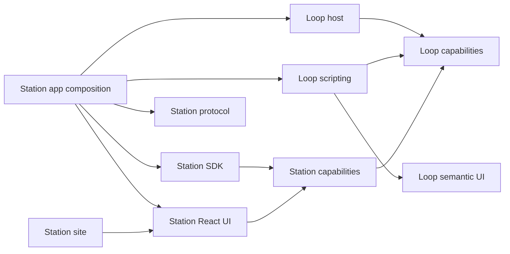

# Current architecture

## Package and module rules

The versioned dependency authority is
[architecture-policy.json](../tooling/architecture-policy.json). Run `bun run check`
locally; CI runs the same policy and deliberate rejection fixtures. The single
integrated [engineering plan](engineering-plan.md) owns this mission's gate and
remaining work and its [package foundation baseline](engineering-plan.md#package-foundation-baseline-2026-10-19).

| Role | Owns | Allowed inward dependencies |
| --- | --- | --- |
| Contracts | Public identities, schemas, descriptors, interfaces | Contracts |
| Domain | Pure models, reducers, algorithms, invariants | Contracts, domain |
| Application | Operations and injected dependency ports | Contracts, domain, application |
| Providers/adapters | Concrete storage, network, runtime, platform implementations | Inward public interfaces |
| Presentation | UI over typed state, actions, controllers | Inward public interfaces |
| Composition | Construction, binding, startup, disposal | Necessary public implementations |

Package cohesive responsibilities, not one package per role. npm workspaces and
runtime-installable Station contributions are distinct: contributions are authored
assets with separately reviewed manifests, grants and activation lifecycles.

Loop Kit owns portable capabilities (identities/operation descriptors), host
(provider registration, resolution, scopes, ownership, leases and lifecycle),
scripting (authored execution contracts and typed bindings), and ui (semantic
descriptions, events and renderer-independent composition). Allowed package edges
are host to capabilities and scripting to capabilities/ui. None imports Station.
Rust host/CLI remain optional existing native implementations, separate from
ordinary TypeScript/browser consumers and from the experimental WASIP3 probes.

Station owns workspace/desks/assets, commands, permissions, installation UX,
docking, editors and concrete platform adapters. `@station/capabilities` keeps its
name and existing entrypoints: renaming to contracts currently adds compatibility
cost without a demonstrated consumer benefit. Protocol owns private Zod task and
operation data. SDK owns the guest browser adapter; UI owns trusted React
primitives. Apps compose these public packages. Move implementations upstream
only after real portable reuse; never move product permissions or workspace state.

Package checks reject undeclared dependencies, private relative/alias/deep imports,
forbidden edges and cycles including type-only and manifest edges. Internal rules
classify core as domain, command-runtime and its ports as application, services
and providers as adapters, UI as presentation, and bootstrap/server/desktop as
composition. Longest-prefix overrides identify application-owned interfaces and
generated immutable data. Domain/application cannot import React, platform APIs,
browser globals or product bootstrap. Providers and presentation cannot import
each other's private implementations. No separately packaged product features
exist yet; internal feature APIs are exported module contracts under these rules.
Define a public feature entrypoint before extracting a feature package.

Existing presentation violations and four cyclic module groups are exact,
owner-assigned migration exceptions, not permission for new edges. The count
ceiling requires review; stale exceptions fail. Module-cycle exceptions fingerprint
their full edge set so adding an edge inside the same group also fails.

Use specialized interfaces and `createX(deps)` factories. Composition constructs
resources and passes the smallest ports; avoid global service lookup. Command
program/diagnostic ports now describe consumed operations explicitly instead of
inferring concrete service implementation types. Resource ownership means cleanup
and cancellation, not authorization: retained JS references are not secured by
scope revocation. Station still authorizes each effect/resource. This follows
[Evolu dependency injection](https://www.evolu.dev/docs/dependency-injection) and
[resource management](https://www.evolu.dev/docs/resource-management); it introduces
no container or service locator.

Nontrivial subsystem modules need purpose TSDoc. Public/reusable APIs document
invariants, errors, authority, resource owner and disposal requirements, plus a
small usage example when useful. Review coupling and responsibility/dependency
reach rather than line count. [Tooling](../tooling/README.md) owns the CLI and
package-owner task/handoff workflow.

### Local Loop Kit development

Host runtime expansion, 2026-10-20: the [lifecycle contract](https://github.com/isaac10334/loop/blob/main/packages/host/LIFECYCLE.md)
defines retained/transferred/borrowed leases, explicit shared generations, eager
named services and bindings, structured tasks, deadlines, activation and cleanup.
The authoritative implementation is in the independent Loop checkout; Station consumes
its versioned packages. Revocation invalidates lease getters;
previously extracted JavaScript values still need provider-side cancellation and
authorization. Lease signals follow consumers; resource signals follow final
ownership. `toLegacyHandle` explicitly adapts the old raw-value/provider-signal
view. Shared services and scope names never confer caller authority. Scripting
execution and semantic UI remain in their existing packages.

Loop Kit is an external semver dependency. Installed packages include built
JavaScript, declarations and the optional scripting engine inputs. Development
links are reversible; clean CI uses frozen installs with no external checkout.
See [the maintained dependency workflow](loop-kit-packages.md) for the temporary
prepublication artifacts, linked edit proof and npm release migration.

## Product behavior

Semantic UI, 2026-10-20: [the maintained contract](semantic-ui.md) owns portable
element/action/icon descriptions, explicit theme inputs, observable controllers
and trusted renderer adapters. Application invocations retain the existing command
authority; shell presentation actions use closed controllers. Reusable metadata
does not carry React values.

Capability cleanup, 2026-10-19: current host consumers use `station:assets/*`,
`station:ai/conversation` and `station:runtime/component-polyengine`; reusable clock
and digest consumers use existing `loop:time/clock` and `loop:crypto/text-digest`.
The seven `unit:workspace/*` JS contracts remain explicit deprecated adapters.
Canonical providers own the implementation; grants apply to the requested identity
and are never silently widened or copied. Existing WIT imports and storage IDs are
unchanged. The inspector shows legacy contracts on request.

## Asset composition and diagnostics

SVG and declarative decision assets reuse workspace identity and source revisions.
Identity reference pickers, independent source variants, editor routing and scoped
source-file grants use the existing command registry. The dashboard saves a bounded
whole-grid width in the same dock document. Loop Kit lifecycle metadata and command
activity feed a bounded session timeline. See [composition and decisions](composition-and-decisions.md)
for implemented boundaries and remaining execution/workflow work.

Widget recipes use local source keys for child target bindings; instantiation and
desk cloning remap live widget/slot identities atomically. Nested App shells own
independent navigation targets in the same docking graph. Widget lists reuse that
ownership for inline entries and targeted tab launchers. SVG editing uses validated
image resources with host-authored interaction geometry and source revision checks.

## Hosted accounts

The optional public Bun entry point (`server/cloud.ts`) serves Station with Better
Auth, database sessions, browser installation observations, presence, pings and
remote logout. It excludes local/native control and Component build authority.
This single-process slice supports SQLite or Postgres. Workspace data remains
browser-local and shared by local users of that profile; account sync, encryption,
Electric and Iroh are future work. See [Accounts and sync](accounts-and-sync.md).

## Desktop distribution

The Windows Electrobun app packages the standalone frontend, Bun backend,

Component worker and pinned translator. `apps/station/server/station-server.ts` owns the shared

app-origin API handler; `apps/station/server/server.ts` supplies development resources and

`apps/station/desktop/main.ts` supplies installed resources and persistent user artifact paths.

The desktop uses a fixed loopback origin and sandboxed native WebView2 without

native RPC. Canary updates download automatically and apply only on explicit

restart; persistent data stays outside the replaced bundle. See [desktop](desktop.md).

## Local app

`apps/station/server/server.ts` is a single Bun server bound to localhost. Bun serves `index.html` as a fullstack HTML route and bundles the TypeScript frontend in development. `bun run build` produces one standalone `apps/station/dist/index.html`; Component builds require the Bun server. Workspace source remains in browser storage. The server accepts one source project at `/api/component/build` and stores verified Component bytes under `.artifacts/` by SHA-256 for download.

`apps/station/src/main.tsx` mounts `apps/station/src/ui/workspace-app.tsx`. The app has a docked navigation panel, shared toolbar, and controlled `DockHost`. `apps/station/src/core/docking.ts` owns a versioned grid/split/stack layout, typed host policy, migration, and atomic commands. `apps/station/src/ui/docking/react.tsx` renders the main, dashboard, sidebar, and bottom surfaces with one dnd-kit drag coordinator; drag state and dialogs are transient. The store in `apps/station/src/features/workspace/application/store.ts` persists layout, active tabs, sizes, browser view and navigation per desk, with shared assets and immutable package installations per workspace. Widget type is separate from instance ID, so the same built-in widget may be placed more than once. `apps/station/src/ui/asset-browser.tsx` presents a sidebar list or a larger grid/list and provides a Stealth context menu. `apps/station/src/ui/component-view.tsx` renders a Component inside a focusable dock panel. `apps/station/src/ui/web-content-view.tsx` shares owner-scoped file/code/preview/problem widgets with the Component editor and compiles TypeScript projects in browser workers; authored web assets may also have dashboard widget instances. `apps/station/src/ui/dashboard.tsx` renders the dashboard grid and per-widget controls. `apps/station/src/ui/onboarding.tsx` provides local guest and demo entry only. Tailwind v4 and locally imported shadcn/Stealth components live in `apps/station/src/ui/components`, with shared helpers in `apps/station/src/ui/lib` and styles in `apps/station/src/ui/styles.css` and `apps/station/src/ui/tailwind.css`. `components/greeting` remains the Rust/WIT project. `apps/station/src/composition.ts` connects the store to browser `localStorage` and uses the `application.ts` factory to register the existing Component runner with the linked `@loop-kit/capabilities` and `@loop-kit/host` packages. It acquires a runner for each run and revokes its scope afterward. Data uses the `unit-workspace.v4` key and migrates older flat layouts. Asset source and panel placement belong to a workspace; Component grants and artifacts are specific to Component assets. Appearance and AI provider preferences belong to the app. AI credentials and preferences are managed separately from desk templates; the AI conversation provider performs granted streaming and tools.

Stealth neutral tokens in `apps/station/src/ui/styles/stealth.css` drive light and dark themes; `apps/station/src/ui/tailwind.css` maps them to shadcn tokens. Fonttrio Technical supplies IBM Plex Sans for headings and body text and IBM Plex Mono for code. `bun run styles` creates `apps/station/src/ui/generated.css` and copies its font assets before the standalone HTML build. Dashboard widgets, including an optional GameKit Snake widget, are built-in React UI, not Component plugins. Eligible built-in widgets can float with stable panel IDs and return to a dock. Broader tiling presets and plugin surfaces remain [exploratory work](explorations/surface-system.md).

Docking policy is host-owned typed configuration. Main permits four leaf stacks, sidebar and bottom one each, and dashboard and each Layout subtree 100 slots. Required home and navigation instances cannot enter Layouts; the singleton Asset browser can move between main tabs, dashboard/Layout slots and docks. These required instances cannot float. The bottom dock retains an empty slot when its last panel leaves and has an independent visibility control. The shared main toolbar sits below its real tab rail, while split leaves own local rails. Layout and floating placement persist per workspace; surface visibility persists per desk; bounded undo/redo history is session-only and desk-specific. See [docking system](../apps/station/src/ui/docking/README.md).

Station uses one v5 dock document, including an ordered compact-widget toolbar surface. `panels` is the compatibility widget-instance table; `containers[instanceId]` references a Layout widget's owned subtree in the same document. `widget-catalog.ts` supplies reusable definition/provider/renderer metadata for built-in content, editor views and authored web widgets. Additional editor instances share underlying source, while presentation and section state remain independent. Moves retain the ID and configuration; swaps validate both directions. Validation checks the entire ownership graph, unique placements, required instances, active tabs, normalized ratios, limits and cycles. Migration repairs v1–v3 trees and retains serialized `stack` widget IDs while replacing canned content with real children.

Grid nodes order bento rows; split nodes determine resizable columns and rows within each backing group. The host supplies a 380 px row extent (480 px below 640 px), with overflowing content scrolling inside its slot. Those extents are presentation policy, not separately persisted widget coordinates. Horizontal splits present vertically on narrow screens without rewriting the saved axis. Resize ratios are normalized, bounded to 20–80%, and undoable. Empty slots are intentionally retained. Removing an occupied slot is rejected; removing a Layout promotes its direct children to the dashboard in one recoverable command. Removing an instance keeps its source content; deleting content removes all its instances and clears layout history.

Widget headings pick up after 6 px of mouse/pen movement, or a 400 ms touch hold within 6 px. Touch pickup continues in the same gesture. Space/Enter picks up directly; arrows navigate destinations, Enter commits, and Escape cancels. Edit widgets exposes removal controls with static outlines; Done or Escape exits editing. Tabs expose inactive children, which retain a metadata preview until visible. `DockHost.widgetDragMode` selects physical or badge pickup globally or per instance, with a per-handle override. Physical pickup translates the existing live presentation and Layout descendants, leaving a placeholder without cloning or remounting content. Occupied single-instance slots swap on release; Alt joins tabs, Shift requests the nearest split edge. Previews never change persistent placement; a successful move commits one command/history entry. Automatic drag scrolling stays disabled.

`docking/presentations.tsx` mounts each instance once in a persistent host layer. Backing slot anchors supply bounds, clipping and input eligibility. Batched DOM measurements update frame styles directly, without rerendering widget content on scroll; nested frames predict owner translation in the same frame. Geometry observation ignores its own writes and unrelated animation/scrollbar styles. Stealth ScrollArea provides native viewports and thin overlay bars for the dashboard, widget content/settings and asset editors. Content owns its wheel gesture through its scroll boundaries; heading/background wheel input forwards once to the backing viewport. Focus restoration uses nearest-edge scrolling. Edit mode uses static outlines so content and scrollbars stay still. Transfers change geometry rather than DOM parentage, retaining editors, iframes and Component view services. Inactive tabs stay mounted, hidden and inert. Carousel children stay mounted and may be visible during native horizontal scrolling, but only the active child is interactive; settled scrolling changes the active ID. Reload and workspace switching create a fresh execution session. Source edits still invalidate artifacts or update authored widget documents. Weather requests location only when pressed; built-in content remains distinct from Component authority.

## Workspace search and navigation

`workspace-search.ts` derives one live catalog of authored assets and existing panels. The Stealth command palette searches it alongside app actions. Ordinary queries search all groups; `assets:` and `panels:` narrow content, `actions:` or `>` select commands, and `search:` selects both content groups. The main search control opens this same palette in content mode. Matching includes asset descriptions and Component filenames, but does not index source file contents. No second search dialog exists.

The existing required navigation dock panel renders `components/workspace/workspace-navigation.tsx`. Its per-workspace `navigation` preference stores query, source/asset-type facets, ordering, explicit pins, and exclusions. Missing preferences migrate to asset results with Overview and Asset browser pinned. Pins bypass matching, while exclusions win; missing references simply do not render. Dropping a local asset onto navigation pins it, and the filter editor supplies a keyboard-accessible pin picker. Removing a navigation entry only excludes the reference. These preferences are independent of structural layout history. Navigation remains the host-owned singleton in the side dock, not a new general-purpose or guest widget type.

Reusable built-in shell components live in `apps/station/src/ui/components/workspace`; interaction primitives live in `apps/station/src/ui/components/ui`. See the [component inventory and styling conventions](../apps/station/src/ui/components/README.md). Toolbar buttons share `IconAction`/`ActionTooltip`, including composed menu triggers.

## Web content path

### Asset terminology compatibility

The current model uses `Asset`, `ComponentAsset`, `WebContentAsset`, `assets`, and `selectedAssetId`. Loading the existing `unit-workspace.v4` key accepts legacy `units` and `selectedUnitId` fields. Dock migration maps the old `unit` kind and `unitId` field, plus browser/editor panel references, to asset terminology across tabs, nested containers, floating positions and maximization. Subsequent saves emit current model fields. Authored source, HTML, revisions, instance IDs, grants and artifact metadata are preserved. Historical storage/session/game keys, external project names and the versioned `unit:workspace` WIT/capability namespace remain compatible. They are identifiers, not current product vocabulary.

Local package/theme assets, installed web widgets/editors, browser TypeScript tooling, SDK communication and configurable desks are implemented. Their current boundaries are documented in [local extensions and desks](extensions.md). Remote distribution, custom asset type registration, long-lived guest providers and portable WASM UI remain exploratory.

Web content assets persist a source file map, migrating legacy HTML into `index.html`. The shared IDE uses real owner-bound dock children and CodeMirror. Worker builds compile local scripts/styles and curated React dependencies into a self-contained document; TypeScript workers provide semantic diagnostics and completion. Builds and runs remain bound to exact source identity and revision. Preview replacement is explicit and failed builds retain the previous successful document. Both previews and widgets use opaque-origin `srcDoc` frames with `sandbox="allow-scripts"` and restricted CSP. A validated private-port SDK bridge grants only declared operations and opened-asset bindings; ordinary previews have no privileged grants. Theme tokens update live. Unexpected navigation revokes the port. This is not a hostile-marketplace isolation claim.

The Bun server rejects `/api/*` requests with a foreign or `null` Origin, rejects cross-site Fetch Metadata, and requires the exact app Origin for mutating requests. These checks protect Component build and artifact routes from opaque iframe requests. The app is still a localhost, single-user application: its API is not authenticated for remote deployment. A CSP on a `srcDoc` document does not guarantee that a navigated iframe keeps that policy, so this initial web asset must not be represented as a network-proof marketplace runtime. Marketplace content needs separate-origin serving with response headers, navigation and communication rules, backend authentication, resource limits, and review before installation.

## Capability host and inspector

`application.ts` owns one application-wide Loop Kit host, a named application scope, and one child scope for every saved workspace and a replaceable child scope for its active desk. The store reads all saved workspace data at startup; creating a scope neither mounts that workspace's UI nor runs its assets. An inactive workspace can have a real, idle ownership scope. Providers register on the application host, not on individual scopes. Acquiring a capability asks its provider to create a fresh service instance owned by the requesting scope; merely defining or registering a capability creates no instances. Workspace renaming updates display metadata. `openScope(workspaceId, name)` binds a consumer to one workspace through a private WeakMap and places it under that workspace's active desk scope. Built-in clock widget acquisitions and Component invocations have their own child scopes; finishing or unmounting revokes them. All host scopes, including idle workspaces, are reflected regardless of asset selection. Scope IDs and acquisitions are session-local and never persisted. Parent revocation cascades to descendants; providers remain available to other scopes. The inspector reads cached, deeply frozen snapshots through a subscription; reflection exposes no provider values or lifecycle controls. Completed scopes/acquisitions are removed after cleanup, with no retained activity history.

`workspace-capabilities.ts` defines trusted built-in JS capabilities: a wall clock with abort-owned timer subscriptions, bounded local SHA-256 text hashing, and a read-only workspace asset catalog. Catalog instances use the private scope binding, never a diagnostic name or parent ID, to select the workspace. Results contain only immutable names, IDs, kinds and revisions, with no source, settings or grants. These implementations check cancellation on operations; these checks supplement Loop Kit's cooperative lifecycle. The existing profile-specific Component runtime provider retains its identity and worker boundary.

The capability inspector has three tabs: Capabilities, Scopes and Grants. Capabilities combines definitions and provider implementations in a namespace → contract package → capability/version tree. Full capability IDs and provider names remain visible in collapsed rows. Expansion shows the definition, exact-version implementations, their scope uses, and bounded test actions. Scopes shows the same capability/provider presentation for each owned acquisition; subtree counts include creation and cleanup, and empty subtrees are labeled idle. Provider attribution joins by acquisition identity, so a removing registration and its replacement never exchange ownership in the UI. Shared presentation lives in `capability-inspector.tsx`; pure snapshot joins and scope counts live in `capability-inspection.ts`. These groups come from existing `namespace:package/path` IDs, not npm package names. Station documents its built-in JS contracts with `Host.define()`; definitions can exist without a provider and survive provider removal until host disposal. TypeScript members are not inferred at runtime. Clock, digest and catalog test actions end their scope in `finally`. Only the runtime provider directs users to the Component editor's verified build/run flow; other contracts without an inspector action retain their own consumer flow. Grants explicitly lists all Components in the current workspace, without selecting a fallback asset. The inspector and Component editor share `component-grants.ts`. Grant edits still go through the store and cancel an active run when a required grant is revoked. Built-in JS capabilities are not new WIT imports. The guest bridge exposes only explicitly adapted, declared and granted operations; it never exposes arbitrary providers. Scope names/parentage express lifecycle ownership, not permissions.

## AI chat and widget grants

AI chat is a built-in React widget available from Add widgets. Each mounted instance starts with no grants and no transcript. Users explicitly grant Gateway access, source-free asset listing, asset source reading, or web draft creation. `ai-tools.ts` maps these operations to validated AI SDK tool schemas; only granted tools are advertised. `widget-grants.ts` checks acquisition and retained method calls and revokes owned Loop Kit scopes. Widget removal, workspace switching, settings changes and grant edits cancel active work. Grant changes reset model history; they cannot retract data already sent. These are application permission checks for trusted built-ins, not isolation for arbitrary React or JavaScript. Existing built-ins retain their current authority; the AI path does not expand authored iframe or WIT authority.

`ai-capabilities.ts` uses pinned AI SDK 7 with Vercel AI Gateway directly from the browser. Keys are user settings outside workspace persistence and tool results, held in memory by default. Remembering a key explicitly stores plaintext in a separate local-storage key; same-origin scripts can read it. The key is never added to prompts or tool output. The Gateway endpoint is fixed; there is no arbitrary credential destination. Each turn has a five-step limit, 4,096 output tokens and a 120-second deadline; prompts and source reads are bounded. User/model/tool conversation messages are retained only in the mounted widget. Every draft write requires inline source review, creates a fresh asset atomically, and neither places nor runs it. There are no AI delete, overwrite, execute, build or grant-management tools. Real model responses require a user-provided Gateway key and credits; test fixtures are not live inference verification.

## Component path

The asset browser keeps multi-selection as temporary view state. Toolbar, context menu, and Delete key actions confirm before one store update removes the selected assets and their dock panels. Each asset has an instance ID, including assets migrated from older storage, so a build finishing after deletion cannot install onto a replacement with the same slug and source.

`components/greeting` is an editable Rust/WIT source project. Its world exports `async run(string) -> string`, imports a P3 monotonic clock, and uses a host-provided future and stream in addition to logging and a bounded text surface. `bun run build:component` builds it with pinned nightly Rust and `wit-bindgen` 0.60.0 for `wasm32-wasip2`, inspects the resulting Component with Polyengine, invokes it, and embeds only sample source into the app. The target name does not determine the Component profile: inspected async types and `wasi:*@0.3.1` imports do. Rust's standard library also contributes recorded `wasi:*@0.2.12` imports.

`apps/station/src/providers/component-runtime.ts` selects the Polyengine provider for the inspected P3 profile, verifies downloaded bytes, and transfers them to a one-shot fixed worker. The worker checks the pinned translator asset hash, translates and inspects the bytes again, rejects unsupported imports, and instantiates with run-local WIT providers and Polyengine's minimal WASI capture/empty-filesystem provider. WIT grants are checked before execution and again at each workspace host effect. The host supplies a Promise and ReadableStream for the P3 future and stream; handles stay in the worker. The worker returns bounded plain results and effects, then terminates. Abort, grant revocation, source changes, deletion, and a 30-second timeout also terminate it. Loop Kit's host acquires and revokes the runtime capability; its signal is cooperative and does not enforce guest permissions. The worker is the hard stop.

`apps/station/server/component-build.ts` creates a nonpersistent Vercel Sandbox from the pinned 30-day snapshot in `apps/station/vercel-sandbox.json` for each build. It uploads the asset's Cargo lockfile, Rust, and authored/vendored WIT, runs nightly `cargo build --release --offline --locked --target wasm32-wasip2` with network denied, inspects the actual P3 world/imports, hashes the bytes, and deletes the Sandbox. The versioned manifest records a unique build ID, canonical source and WIT hashes, byte hash/count, inspected world/imports, profile, toolchain, snapshot ID, and translator hash. Wasm bytes are content-addressed; each build gets a separate immutable manifest even when different sources compile to identical bytes. This is recorded provenance, not a cryptographic build attestation. The client fetches and verifies the exact bytes before install and again before each run. Source edits invalidate the artifact; an instance ID prevents a deleted/recreated asset from receiving a prior build.

This locally authored Component path is not a marketplace security boundary. Wasm isolates guest memory, while the same-origin worker and import membrane limit authority. Polyengine does not claim hostile-guest confinement from provider checks alone. A separate-origin runner, tighter resource accounting, and a third-party iframe policy are required before untrusted marketplace Components are accepted. See [runtime measurements](component-runtime-profile.md).

The programmable workspace foundation now selects wasm-rquickjs v0.4.13 for its
separate scripting experiment on the same Polyengine 0.6.7 runtime. The bounded
lifecycle proof lives in `apps/station/scripts/scripting-proof` and upstream
`experiments/station-p3-scripting`. Fixed workers execute verified reusable engine
bytes; external fixture hosts own cancellable subscriptions and surface resources.
Build-time source/dependency identity, inspected memory maxima, explicit bindings,
retained-handle/revocation checks and CPU termination are exercised in Node and
Browser. These fixtures do not register new application operations or production
Component profiles. Inline authoring, real services and portable UI adapters remain
pending. The componentize-qjs/Wasmtime workaround is documented as a deferred
option. See [the current implementation status](programmable-workspace-foundation.md).

## Component approval and desktop side dock

The Run tab requests missing Component authority through a modal approval dialog. Deny/dismiss does not invoke the runner. Allow once creates invocation-owned authority in `application.ts`; it is never written to storage and expires in `finally`. Always allow atomically saves the existing boolean asset grants. Existing saved grants retain their meaning. Saved approval covers future revisions of that asset in that workspace; new grant IDs still require approval. Approval captures the displayed source revision and artifact hash, and rejects changes before invocation. The current P3 profile requires all four bounded imports.

`components/workspace/component-permissions.tsx` shares the grant ledger between editor settings and the capability inspector. Both show saved and active one-run authority and can revoke it. Store revocation notifications also fire when the saved boolean was already false, allowing cancellation of one-run approvals. All execution still validates source/bytes and uses the worker import membrane.

The desktop side dock stores `sidebarWidth` in the existing dock document (220–520 CSS pixels, legacy default 310). Its edge previews geometry during pointer movement, commits through `resizeSidebar`, supports arrow/Home/End keys, Escape cancellation, and double-click reset. Narrow screens retain mobile dock behavior and the saved desktop width.

## Repository and public packages

`apps/station/src/application.ts` now owns the import-safe application factory;
`composition.ts` is only the browser bootstrap. Headless consumers can construct
and dispose the same state/capability lifecycle with explicit storage and a runner
without starting localStorage-backed singleton services. Package runtime services
use their own small dependency interface. Recursive AST import tests cover aliases,
dynamic imports and re-exports as well as nested core files and public packages.
The shared Zod command registry serves trusted UI, scoped SDK adapters, internal
agent task tools, CLI and generated stdio MCP. Opaque host-created contexts and
resource-scoped expiring task grants authorize each operation and result. The
trusted Bun desktop broker owns pairing credentials and exact renderer routing;
the renderer remains the sole live store owner. Headless profiles supply explicit
storage, build and fixed-worker Component adapters. Task installation authority
expires rather than becoming persistent permission. See [Agent control](agent-control.md)
for lifecycle, transports, security limits, supported operations and acceptance.
Public remote HTTP MCP, complete UI parity, arbitrary npm/native tools and shared
desktop/headless persistence remain outside this implementation.

The repository is a Bun workspace with one private application under `apps/station`, independently packable `@station/sdk` and `@station/capabilities` under `packages`, and external versioned Loop Kit dependencies. The root manifest coordinates commands and owns no application dependencies. See the [application boundary map](../apps/station/README.md). Core state and reducers do not import React, effectful services, providers, or bootstrap; a test enforces this. Application composition registers providers and supplies explicit dependencies to package services. Public capability identities and guest data contracts are separate from provider implementations. Workers, compiler declarations, fonts, and desktop resources resolve package entrypoints rather than assuming dependencies live in root `node_modules`.

The Files pane uses a shared Stealth tree with folder hierarchy, keyboard movement and file operations. Resize callbacks that write React/layout/canvas state are coalesced into animation frames outside observer delivery; tabs skip unchanged height writes. The workspace picker constrains its scroll region to available popup height. These changes avoid synchronous measurement/write feedback without suppressing observer errors.

Portable semantic elements/events and Station DOM adapters are implemented; source-aware editing and general drawing/GPU contracts retain separate [exploration gates](explorations/surface-system.md#source-aware-editing-drawing-and-gpu). See [Semantic UI](semantic-ui.md) and the [current core-system review](core-systems-review.md).

## Forkable UI and source-sharing prototype

The [forkability and collaboration checkpoint](forkable-workspaces.md) documents implemented behavior and remaining proposals. `core/workspace-sharing.ts` owns source wire validation and authoritative revision/grant policy; `server/workspace-rooms.ts` binds invitations to WebSocket participants; `services/workspace-sharing.ts` owns the client connection, conflict preservation and subscriptions. Source sharing does not copy runtime authority or synchronize private layouts. The development server supports bounded rooms; the packaged desktop API does not yet expose them. Network-exposed development servers disable Component APIs.

`@station/capabilities/icons` contains semantic icon names. Private `@station/ui` shares React icons and portable guest controls with Station and the static download site. The curated compiler resources include its JavaScript/declarations. Theme JSON can reference SVG files in authored assets; static host icon images are validated separately from sandboxed SVG preview content. The visual theme editor edits the same source as Code. Package import/export traverses/remaps those icon dependencies. Core policy remains independent of React rendering.

Desk controls are an ordinary compact floating widget in the existing DockLayout graph. The one-time desk reference preserves removal across reload; movement and inspection reuse the normal widget owner. This is not a general ordered/passthrough layer system or a public layout capability. Installed source forks have fresh manifest identities and no copied grants/artifacts. Editor pane recovery uses `createEditorPart` and the existing owned slot graph.

## Chat and shared presentation refinements

The default chat model is GPT-6 Luna; saved selections remain explicit user choices. `core/chat-models.ts` records a checked public Gateway metadata snapshot, separate from credentials and model execution. `providers/station-assistant-context.ts` contains product knowledge and authority boundaries; it does not include private workspace data. Live asset reads remain grant-bound tools. The model picker never enables tools or starts a request. Chat is a bounded flex surface with a single message scroller.

`features/ai/infrastructure/model-catalog.ts` discovers public language models through the fixed, unauthenticated Gateway models endpoint. It validates IDs, names and base token prices, limits downloads to 2 MiB and ten seconds, caches a timestamped validated snapshot for 24 hours, and falls back to the curated offline snapshot. The small recommended picker remains available alongside searchable expanded/custom-ID selection. Catalog presence does not imply account eligibility. Prices are base USD per million tokens; context/service tiers, caching and reasoning can alter charges. Discovery sends no user key and never selects a replacement model or enables tools.

Chat turns render inert streaming Markdown/code with explicit copy and retry/stopped states. HTML is escaped and link schemes are allowlisted; no reply or review source is executed. Header/model/tools/New chat and composer sit outside the bounded message scroller. Growth follows only within 32px of the bottom; upward reading is preserved until Jump to latest. Streaming text has no live region; only coarse status changes are announced. A chat retains at most 40 visible turns without silently dropping old rows. Model/settings or batch session-grant changes clear both visible and provider history. Widget removal, desk/workspace switching, provider revocation and Stop abort the provider, settle pending review, revoke scopes and remove owned subscriptions.

Live context is requested through explicit tools, capped at 20 reads and 96 KiB of serialized results per turn (each source read remains capped at 64 KiB). Each assistant turn exposes its exact successful resource results in the context inspector and bounded tool progress/results separately. Untrusted resource content stays in tool messages; only `station-assistant-context.ts` supplies trusted product instructions. Concurrent draft proposals cannot replace an existing review. Saving a reviewed draft stores new source only; authoring, review, installation and activation remain separate operations.

Default colors/fonts and the theme reveal now live in private `@station/ui` for host/site reuse. Theme number fields hold temporary strings locally and commit validated values to the same theme.json source on blur/Enter. Icon assets come from the shared S polygon; SVGL Windows/GitHub geometry is attributed in the site handoff. Remaining checkpoint work is tracked in [the next checkpoint prompts](prompts/next-station-checkpoints.md).

## Browser context capability foundation

`@station/capabilities` defines `station:browser/contexts`: bounded serializable browser operations with acquisition-owned resources, without page evaluation or native handles. Web browser composes a Layout with movable browser-tab children. Each child stores its validated path bookmark on its own dock panel, uses an explicit session grant, revokes on unmount/desk switching and preserves its acquisition during movement. Browser-only hosts show an explicit desktop fallback. The private desktop HTTP controller validates origin, Fetch Metadata, session secret and payload limits; native leases expire when the renderer stops renewing.

Windows browsing uses sandboxed native WebView2 BrowserViews through a private Bun controller. A reproducible patch to Electrobun 2.0.3-beta.26 removes unsafe upstream arguments and installs policy before navigation: explicit InPrivate partitions, no guest preloads/bridges, native URL/resource guards, and default denial of downloads, permissions, popups and external protocols. Co(lab)-inspired presentation hides retained views for shell overlays, drag, occlusion and partial clipping. Root reload revokes all browser leases. Installed native probes verify real sites, navigation, isolation, policy and cleanup; this is not a network firewall or atomic native masking. See [browser contexts](native-browser.md) for patch ownership, verification and deferred receiver grants.

## Composable widget chrome and browser children

`WidgetFrame` and `WidgetSettings` share one controls surface between ellipsis /
context menus, the flip side and the Docking inspector. Standard, compact and
seamless chrome are per-instance presentation metadata. Controls remain reachable
by hover, keyboard, touch and inspector selection. Nested single-child Layouts
avoid redundant rails and padding; real owner content fills its measured slot.
Fullscreen focus uses the same mounted instance layer in a native modal dialog,
with scoped overlay portals and no saved placement change.

The Web browser now composes `LayoutWidget ownerId` with ordinary `browser-tab`
children. Each tab retains its one-page bookmark configuration, stable panel ID,
and explicit per-instance browsing scope when moved to another Layout. Existing
saved browser arrays migrate into the same dock graph. Package/editor logical
ownership and existing grant boundaries remain distinct from these movable
Layout children. Headless commands own persistence/history; React controller
methods own transient menus, selection and focus. See the docking README for API
examples. Native session movement still requires managed-desktop acceptance;
browser-only fallback and service tests do not establish that acceptance.

## Widget definitions and React integration

The [widget system](widget-system.md) keeps pure placement/actions/recipe validation
in `core` and presentation in React. Built-in definition metadata is registered
once and projected as read-only virtual assets. Editable forks configure existing
trusted renderers; they do not install executable code or grant services. Instance
settings are snapshots, compatible recipe changes preserve identity/state, and
cross-renderer migrations remain unsupported. No widget package extraction or
second layout store was introduced.

Desktop root credentials are not embedded in loopback HTML. A fixed, origin-checked
native host bootstrap delivers them to the exact root WebView after DOM readiness;
foreign pages and ordinary loopback browsers cannot obtain them from HTTP. Root
reload revokes agent credentials before the new renderer registers. Private build,
agent, browser and update routes remain distinct from sandbox SDK authority.
Installed acceptance of this bootstrap is required independently of web tests.

## Root shell and template authoring

`core/docking.ts` persists a desk's root shell ID beside its instance table and
named surfaces. `ui/components/workspace/app-shell-widget.tsx` composes the App
shell and Desktop shell with the same DockHost, retained presentations and overlay
children. The root is protected from ordinary movement/removal. Legacy desks gain
an App shell root during migration; navigation/browser/home wire identities remain.

`core/desk-templates.ts` validates `desk-template` source assets and projects the
Built-in App desk/Desktop templates. Snapshot export allowlists panel configuration;
cloning remaps root and descendant IDs. The visual definition editor writes current
`widget.json` through the existing source operation, with nested slot-default seeds
instantiated atomically by the dock reducer. Inert previews have no service/runtime
ownership. See [Widget system](widget-system.md) for contracts and limitations.

## Data projections and bounded scripting

Data-source assets own records; Data view widgets own independent query and
presentation settings. Validated shared commands select trusted provider adapters.
Formula columns and script assets use a fresh QuickJS WASM VM through a lifecycle
capability and a serialized worker. Runtime action widgets project configured
instance targets into toolbar pins/overflow. Component compiler providers return
untrusted bytes to one common P3 verifier. See
[Data sources and scripting](data-sources-and-scripting.md) for authority, budgets
and current limitations.

## Programmable workspace authoring

`core/programs.ts` stores drafts, activated snapshots and instance configuration; `features/programs/application/controller.ts` owns disposable workers, bindings, surfaces and named shared-service leases. `program-activation.ts` is shared by direct local Apply and package preparation. Source/configuration extraction excludes authority and runtime state. `providers/scripting` independently verifies the scripting and portable UI profiles before executing pinned wasm-rquickjs bytes on Polyengine; it does not replace the existing Component verifier. `@loop-kit/ui` owns the portable semantic contract and recording adapter; Station's `portable-surface.tsx` owns DOM, focus, accessibility and popover presentation. Settings contributions are schema-driven host fields. Custom document types keep namespaced type metadata and document data separate from their defining code. See [programmable foundation](programmable-workspace-foundation.md) for lifecycle and acceptance boundaries.

## Feature responsibility consolidation (October 20, 2026)

The [feature map](../apps/station/src/features/README.md) owns module entrypoints and
lifetimes. Pure asset/workspace values live independently of the persistence store.
The command registry and program lifecycle are application controllers; compiler,
worker and named-service implementations are injected by the root. Chat turn state,
review and task cancellation no longer belong to JSX. Navigation ranking/projection
and history, editor-document selection and clock acquisitions have independent
React-free owners. WorkspaceApp receives explicit shell ports and delegates dialogs
and creation workflows. Typed renderer tables select built-in widgets and asset
editors separately; DockLayout still owns every retained instance.

AST rules cover internal feature roles including infrastructure, type-only imports,
public npm entrypoints and browser globals. Existing migration exceptions can only
shrink. The exact verification limits and remaining singleton consumers are tracked
in [the living plan](engineering-plan.md); these edits do not establish native or
declarative-UI acceptance.
